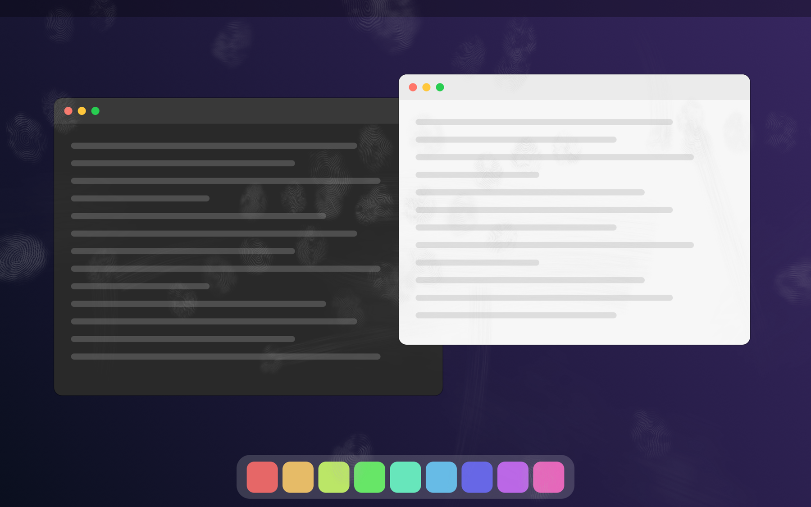

# Smudge

**Greasy fingerprints for your Mac screen. No touchscreen required.**



Smudge is a joke app for two kinds of people:

- those who want to look like they already own the new touchscreen MacBook Pro, and
- those who want to know what life with one feels like before paying for it: every click leaves a fingerprint, and nobody ever wipes the screen.

It puts a transparent overlay on top of every display and covers it with realistic fingerprints, swipe trails and greasy smears. That is all it does. Clicks pass straight through, your windows keep working, and nothing on your Mac is changed.

The picture above is a rendered mock-up, not a real desktop.

## What you get

- **Fingerprints.** Each one is generated from scratch, so no two are alike: loops, whorls and arches, with patchy contact and the occasional smear. They gather where fingers would actually land, around the Dock, the menu bar and the middle of the screen, often two to four at a time.
- **Thumbs on the edges.** Somebody clearly opened the lid by grabbing the display.
- **Swipes and smears.** Scroll trails, drag marks, palm haze, and one hopeless attempt to wipe it all off with a sleeve.
- **Honest grease.** Marks glow faintly on dark content and dim light content slightly, the way a real dirty screen does.
- **Every display, every Space.** Including full-screen apps.

## Menu

Smudge lives in the menu bar under the 👆 icon.

| Item | What it does |
| --- | --- |
| Smudge Again | Throws away the current mess and makes a new one |
| Touch Some More | Adds a few more prints on top |
| Wipe Screen | Cleans everything, for now |
| Light Touch / Everyday Grime / After a Kebab | How bad it is |
| Fingerprint on Every Click | Leaves a print wherever you click, so the screen fills up as you work |
| Quit | Ends the joke |

## Install

Requires macOS 12 or later and the Xcode command line tools (`xcode-select --install`).

```bash
git clone https://github.com/trehkolesniy/smudge-pro.git
cd smudge-pro
./build.sh
open Smudge.app
```

The build is a single Swift file with no dependencies. The resulting app is signed only for local use, so if you copy `Smudge.app` to another Mac, open it the first time with right-click → Open.

## How it works

- One borderless, transparent window per screen sits above everything else and ignores mouse events.
- Fingerprint ridges are computed per pixel: a distance field around a core point (or a line, for loops) is warped with noise and turned into ridges, then masked by an uneven fingertip shape.
- Swipes are noisy streaks stamped along a curve, fading as the "grease" runs out.
- The overlay is a static image, so the app sits idle once it has been drawn.

To regenerate the preview picture:

```bash
./Smudge.app/Contents/MacOS/Smudge --preview docs/preview.png
```

## Good to know

- The overlay shows up in screenshots and screen recordings. This is a feature.
- "Fingerprint on Every Click" listens for mouse clicks only to know where to put the print. Nothing is stored or sent anywhere.
- Not affiliated with Apple. It will not make your screen respond to touch, however hard you press.
